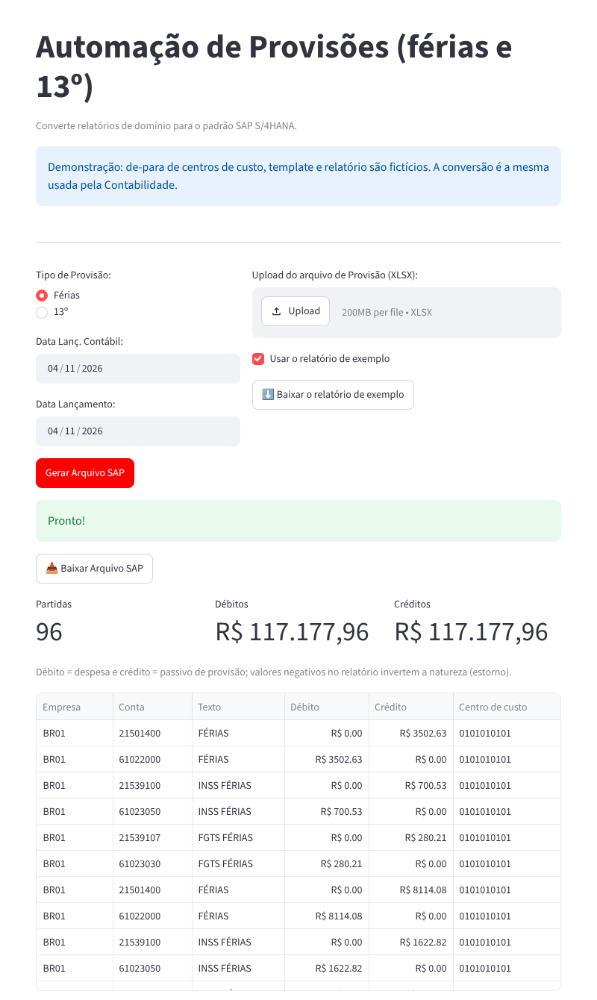

# Vacation and 13th-salary provisions for SAP S/4HANA

[🇧🇷 Português](README.md) | 🇺🇸 English

**▶️ [Open the live demo](https://joao-2003.github.io/sap-payroll-provisions/)**: the app running in the browser (Pyodide + stlite) with a fictitious report, cost-center mapping and template. The first load takes 20 to 60 seconds. The interface is in Portuguese.

A Streamlit app that converts the monthly payroll provision report (vacation and 13th salary, with INSS and FGTS social charges) into the SAP S/4HANA **mass journal entry** upload template.

> I built it for a Brazilian manufacturer, where the Accounting team uses it. The cost center mapping in this repository is fictitious.

## How it works

1. The user picks the provision type (vacation or 13th salary), the document and posting dates, and uploads the Excel report.
2. Each report line is linked to its company code and business place through the cost center (`de_para_CC.xlsx`).
3. For each cost center, the provision, INSS and FGTS amounts become debit (expense) and credit (liability) pairs; negative amounts flip the sign, reversing provisions.
4. The official SAP template is filled in (header with company code, document type SA, dates and reference `PROV FF mm/yyyy` or `PROV 13 mm/yyyy`) and returned for download.



## How to run

```bash
pip install -r requirements.txt
cp de_para_CC_exemplo.xlsx de_para_CC.xlsx          # replace with your cost centers
# download the journal entry template from SAP's "Upload General Journal Entries" app
# and save it as "JournalEntry_Template (1).XLSX" in this folder
streamlit run main.py
```

Without `de_para_CC.xlsx` and the template in the folder (or in the browser), the app runs in demo mode with the files in `demo/`, built by `tools/gerar_exemplos.py`. After generating the file, the screen lists the line items and checks that debits and credits balance.

## Tech stack

Python 3 · Streamlit · pandas · openpyxl · SAP S/4HANA (journal entry upload)

## Author

João Victor Guidi de Lima · [LinkedIn](https://www.linkedin.com/in/joão-lima-8b512) · [GitHub](https://github.com/Joao-2003)
