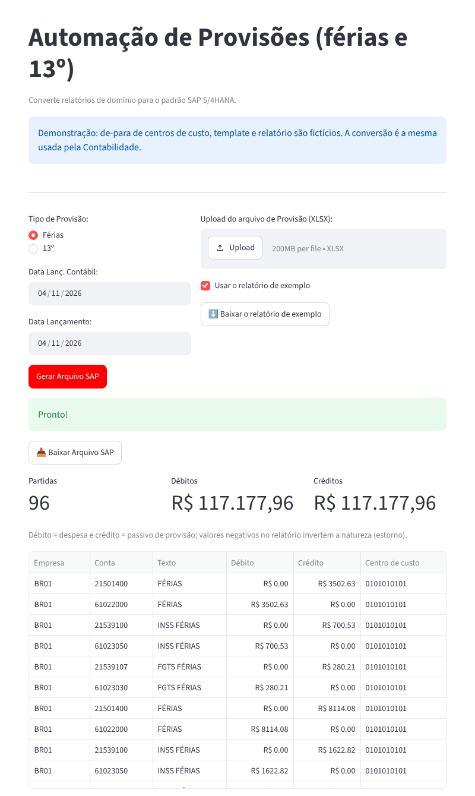

# Provisões de férias e 13º para o SAP S/4HANA

🇧🇷 Português | [🇺🇸 English](README.en.md)

**▶️ [Abrir a demonstração](https://joao-2003.github.io/sap-payroll-provisions/)**: o app rodando no navegador (Pyodide + stlite) com relatório, de-para e template fictícios. A primeira carga leva de 20 a 60 segundos.

Aplicação Streamlit que converte o relatório mensal de provisões da folha (férias e 13º, com INSS e FGTS) no template de **lançamento contábil em massa** do SAP S/4HANA, pronto para upload.

> Desenvolvida por mim para uma indústria brasileira e usada pela Contabilidade. O de-para de centros de custo deste repositório é fictício.

## Como funciona

1. O usuário escolhe o tipo de provisão (férias ou 13º), as datas do documento e do lançamento e envia o relatório em Excel.
2. Cada linha do relatório é ligada à empresa e ao local de negócios pelo centro de custo (`de_para_CC.xlsx`).
3. Para cada centro de custo, os valores de provisão, INSS e FGTS viram pares de débito (despesa) e crédito (passivo); valores negativos invertem a natureza, estornando provisões.
4. O template oficial do SAP é preenchido (cabeçalho com empresa, tipo de documento SA, datas e referência `PROV FF mm/aaaa` ou `PROV 13 mm/aaaa`) e o arquivo é devolvido para download.



## Como executar

```bash
pip install -r requirements.txt
cp de_para_CC_exemplo.xlsx de_para_CC.xlsx          # troque pelos seus centros de custo
# baixe o template de lançamento contábil do app Fiori "Upload General Journal Entries"
# e salve como "JournalEntry_Template (1).XLSX" nesta pasta
streamlit run main.py
```

Sem `de_para_CC.xlsx` e o template na pasta (ou no navegador), o app abre no modo demonstração com os arquivos de `demo/`, gerados por `tools/gerar_exemplos.py`. Depois de gerar o arquivo, a tela mostra as partidas e confere que débitos e créditos fecham.

## Tecnologias

Python 3 · Streamlit · pandas · openpyxl · SAP S/4HANA (upload de lançamentos contábeis)

## Autor

João Victor Guidi de Lima · [LinkedIn](https://www.linkedin.com/in/joão-lima-8b512) · [GitHub](https://github.com/Joao-2003)
